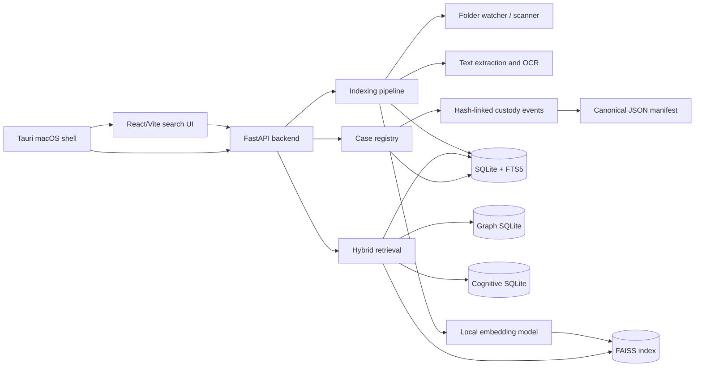

# Architecture

## System diagram



## Backend lifecycle

At startup the FastAPI lifespan:

1. initializes or migrates SQLite schemas;
2. reconciles pending watched files;
3. checks FAISS/embedding availability;
4. initializes graph and cognitive layers;
5. starts event broadcasting and health loops;
6. starts the watcher only when automatic startup indexing is enabled;
7. warms the local model asynchronously.

The SSD-first `start.sh` sets `RECURDO_AUTO_INDEX_ON_START=0`, so a copied library does not begin scanning all persisted folders before the search surface is responsive. An explicit folder add or `/index/trigger` still starts work.

## Indexing pipeline

```text
path discovery
  → extension/exclusion/age/size checks
  → source stat and content hash
  → duplicate/path lookup
  → extraction or OCR
  → SQLite item write
  → FTS trigger update
  → embedding/index write
  → watched-file status
  → progress event
```

Text files use local extractors and the shared embedding model. Images use filename fallback, optional Tesseract OCR, and optional cloud vision/enrichment paths. The current visual path is text-derived; it is not a general image-vector model.

## Retrieval pipeline

Search parses the request into a structured query. Depending on intent and model readiness, it combines:

- FTS5/BM25 candidates;
- dense FAISS candidates;
- sparse keyword weights;
- filename and path overlap;
- metadata/source/file-type signals;
- time-window candidates;
- graph candidates;
- recency/behavior signals;
- cognitive reranking;
- case-evidence filtering.

The pipeline intentionally has a lexical path so search remains useful while the model is cold or unavailable. Exact identifier queries reject dense-only neighbors when no lexical/path/time/graph anchor exists.

## Storage boundaries

The primary persistent state is in `data/`. The source evidence remains at its original path. Custody records a relationship to it; it does not create a sector image or a cryptographically sealed copy.

See [`data-layout.md`](data-layout.md), [`indexing.md`](indexing.md), and [`forensic-boundaries.md`](forensic-boundaries.md).

## Optional integrations

The repository contains compatibility paths for:

- Supabase authentication/access;
- Gemini document/image enrichment;
- Gmail synchronization;
- Tauri update delivery.

Those integrations are not required for local SSD mode. Any enabled integration changes the privacy boundary and must be documented in the investigation record.
